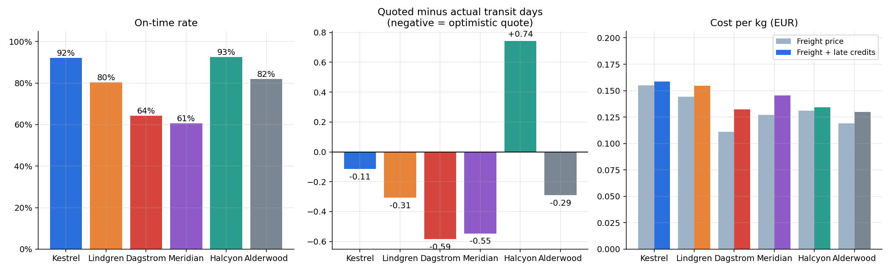
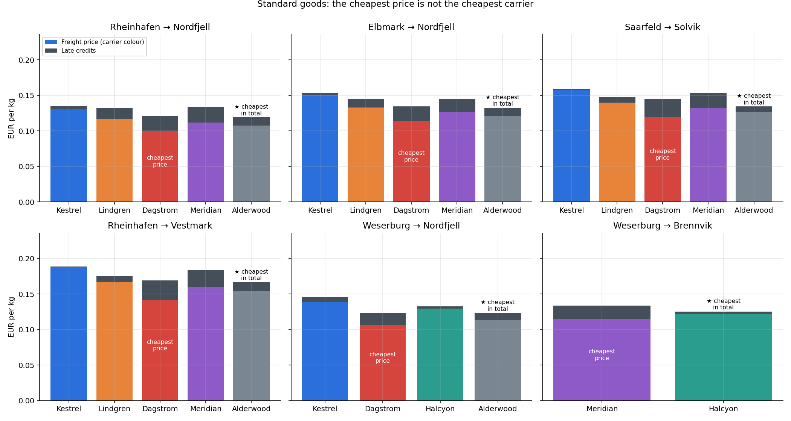
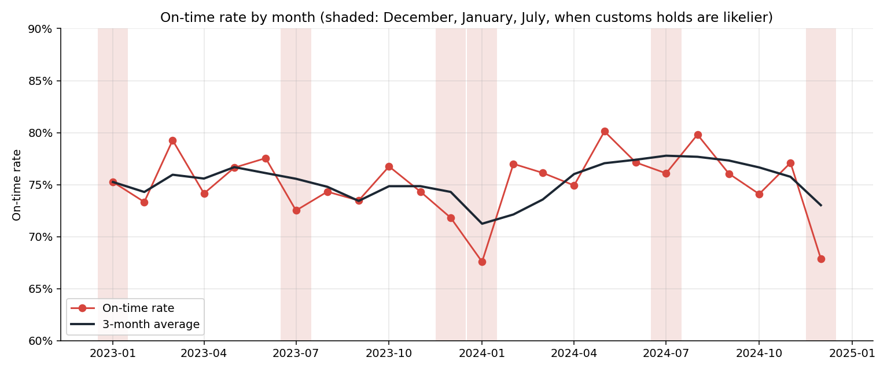
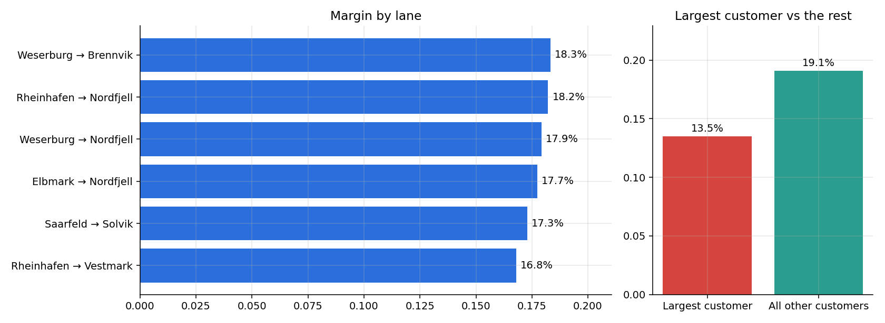
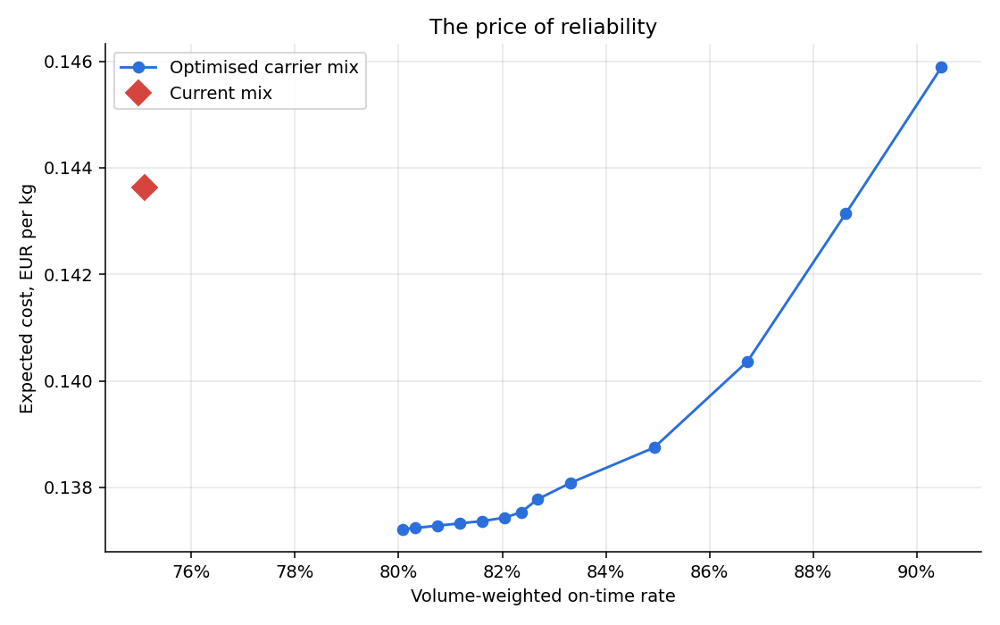

# Cross-border freight analytics

[](https://github.com/Dmkostek/freight-shipment-analytics/actions/workflows/ci.yml)

An end-to-end analytics project on a **simulated, fictional** cross-border chemical freight network: a SQL warehouse with data-quality checks, carrier reliability and cost analysis, a linear-programming model that recommends how to split volume across carriers, and an interactive dashboard.

**[Open the live dashboard](https://dmkostek.github.io/freight-shipment-analytics/)** (`https://dmkostek.github.io/freight-shipment-analytics/`). Filter by year, carrier, lane, transport mode and cargo type with the buttons at the top; the summary and every chart update, and carriers and lanes can be combined.

Everything here is generated. The places, carriers, customers, prices and delays are all invented, and no real company or route is described. The findings below are properties of the simulation, not of any real business; they show what the pipeline surfaces.

## What the analysis finds

Two years, 7,398 delivered shipments, 52,000 tonnes, six carriers, six lanes. Overall 75.3% of shipments arrive within their quoted transit time.

* **The cheapest price is not the cheapest carrier.** Dagstrom Direct has the lowest freight price (€0.111 per kg) but delivers on time only 64% of the time. Once late-delivery credits are added, Alderwood Transport beats it on five lanes, and on the sea lane (Weserburg to Brennvik) Meridian Cross-Border, cheapest by price, loses to Halcyon Marine Cargo. On **all six lanes** the cheapest carrier by price is not the cheapest in total.
* **An "unreliable" carrier may just quote badly.** Meridian Cross-Border carries 30% of the volume and has the worst on-time rate (61%), but its real transit times are ordinary (0.28 days beyond the lane norm, versus 0.31 for Lindgren & Voss). Its quotes are 0.55 days too optimistic on average. Halcyon Marine Cargo does the reverse: it pads its quotes by 0.74 days and so looks very reliable (93%).
* **Customs holds are seasonal.** In December, January and July, 28.2% of shipments are late versus 23.8% in other months (z = 3.65, p = 0.0003).
* **One big customer, thin margin.** The largest customer is 22% of revenue at a 13.5% margin, against 19.1% for everyone else. Rheinhafen to Vestmark is the lowest-margin lane (16.8%).
* **Late credits are not small.** About €660,000 over the period, roughly 9% of freight spend plus credits.
* **A better carrier mix is possible.** The optimiser moves volume away from Dagstrom Direct and Meridian Cross-Border towards Alderwood Transport and Halcyon Marine Cargo and cuts expected cost per kg by 2.3% (about €170,000 over the period) *while* lifting on-time delivery from 75% to 87%.









## How it works

```
simulate  →  raw tables  →  SQL warehouse  →  data-quality checks  →  analysis  →  optimiser  →  dashboard
 (Python)     (6 feeds)     staging → marts      13 checks, stop       pandas       scipy LP      static HTML
                                                 on any failure
```

**The raw feeds are deliberately messy.** About 0.6% of shipment rows are duplicated, 8% of carrier names are spelled inconsistently ("carrier a", "CARRIER A "), and the last few days of shipments are still in transit.

**SQL warehouse** ([`freight/sql`](freight/sql), SQLite from the standard library):

| Layer | What it does |
|---|---|
| `01_staging.sql` | Removes duplicates, standardises carrier names, joins shipments to their costs |
| `02_marts.sql` | Derives lateness, landed cost and margin in one place; builds the carrier, lane, monthly and customer marts with window functions (ranks, rolling averages, shares) |
| `03_checks.sql` | 13 data-quality checks: unique keys, resolvable references, no negative money, delivery after shipping, dangerous goods only with certified carriers, carriers only on modes they serve, the margin identity, and no shipment lost between layers |

**Business rules** live in the SQL, not scattered through code. A shipment is *on time* if delivered within its quoted transit days. A *late credit* is 1% of revenue per day late, capped at five days. *Landed cost* is product, freight, customs, handling, insurance and late credits.

### Carrier optimisation

For each lane and dangerous-goods segment, a linear programme ([`freight/optimize.py`](freight/optimize.py)) chooses what share of volume goes to each carrier. It minimises expected cost (freight plus late credits) subject to an on-time target in every segment and a cap on any single carrier's share of total volume.

With an 85% on-time target and a 45% cap, carrier shares of volume change as follows:

| Carrier | Kestrel Haulage | Lindgren & Voss | Dagstrom Direct | Meridian Cross-Border | Halcyon Marine Cargo | Alderwood Transport |
|---|---|---|---|---|---|---|
| Current share of volume | 15% | 16% | 16% | 30% | 11% | 11% |
| Recommended | 16% | 13% | 0% | 0% | 27% | 44% |

The "price of reliability" curve shows what each on-time target costs. Every target up to about 87% is cheaper than the current mix (an 80% target costs €0.1381 per kg and an 85% target €0.1404, versus €0.1436 now); a 90% target costs 1.6% more than the current mix but lifts on-time delivery from 75% to 90%.



These savings are estimates from historical averages. They assume carriers keep their prices and performance when volumes change, which real carriers often do not.

## Tests

28 tests ([`tests/test_freight.py`](tests/test_freight.py)) cover:

* the simulator is deterministic, every pattern it plants is recovered by the analysis, and no real place name appears anywhere;
* all 13 data-quality checks pass on the clean data, and each one **fails when a problem is injected** (negative cost, wrong lane, unknown carrier, dangerous goods on an uncertified carrier, delivery before shipping);
* the SQL results match an **independent pandas recalculation** of on-time rates and late credits;
* the optimiser returns valid splits, meets its on-time and carrier-share constraints, never costs more than the current mix, and raises a clear error when no split is possible;
* the dashboard embeds every delivered shipment and agrees with the scorecard.

CI runs them on Python 3.10, 3.11 and 3.12 and then runs the whole pipeline.

## Reproduce

```bash
pip install -r requirements.txt
python -m pytest -q          # 28 tests
python -m freight.run        # regenerates data/, results/, figures/ and docs/index.html (~3 s)
```

```
freight/simulate.py            the simulated business and its raw feeds
freight/warehouse.py           loads the feeds, builds the SQL layers, runs the checks
freight/sql/                   staging, marts and data-quality checks
freight/analytics.py           scorecards, cost breakdown, margin, seasonality
freight/optimize.py            carrier allocation as a linear programme
freight/dashboard.py           builds the dashboard (docs/index.html; Plotly.js, MIT, is bundled in docs/)
freight/plots.py               figures for this README
freight/run.py                 runs everything
tests/                         unit, regression and data-quality tests
results/                       generated tables (markdown, CSV, JSON)
```

## Limitations

* **Simulated data.** Real freight data has more structure and more noise, and the patterns here were put there by construction.
* **Estimates, not forecasts.** The optimiser uses historical averages and ignores price changes when volumes shift, capacity limits, contract terms and lead-time requirements.
* **Simple business rules.** The late-credit rule, the flat quote slack and the cost model are deliberately simple and documented in [`freight/simulate.py`](freight/simulate.py) and the SQL.

## Author

Diyar Kostek. Built as a portfolio project drawing on supply-chain analytics experience.

Released under the [MIT License](LICENSE).
